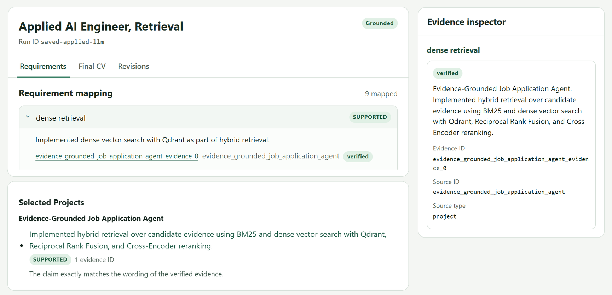
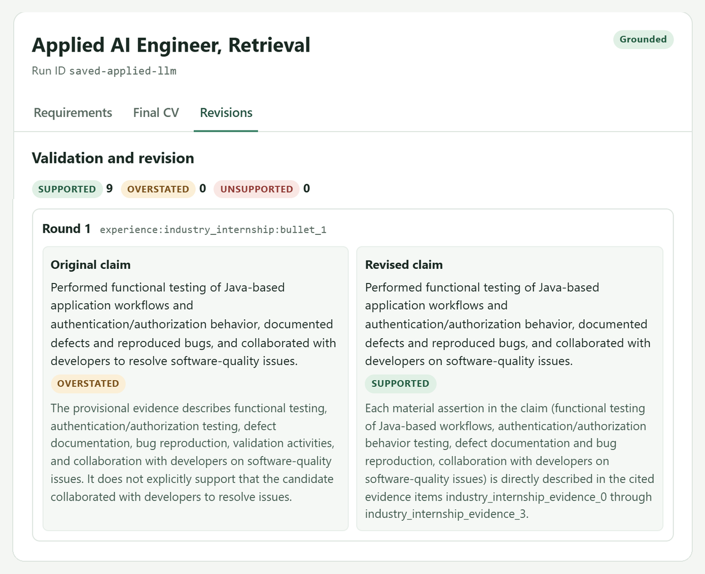

# Evidence-Grounded Job Application Agent

Tailoring a CV to a job description makes it easy to overstate experience. This
agent maps requirements to evidence, attaches evidence IDs to CV claims, and
blocks export when the result needs human review.

## Portfolio demo

Open the workbench in **Saved demo** mode and expand a requirement, inspect a
citation, or compare the original and revised wording under **Revisions**. The
demo ships a redacted projection of the completed Applied AI run. It needs no
backend, model downloads, or API key.

**From requirement to validated CV claim.** Two views of the same saved run show
how the dense retrieval requirement and the CV bullet cite the same verified
project evidence.



**Targeted revision.** The Validator flagged “resolve software-quality issues”
as overstated. After revision, the claim describes collaboration on those
issues, and targeted re-validation records it as supported.



```powershell
cd frontend
npm ci
npm run dev
```

An optional Docker build serves the static portfolio demo.

```powershell
docker build -t job-agent-demo .
docker run --rm -p 127.0.0.1:8080:80 job-agent-demo
```

## Architecture

The React workbench uses FastAPI. A local MCP host can use the same application
service over stdio. Both adapters share run and review state in SQLite. The
service invokes LangGraph and gates final CV access.

[Architecture and LangGraph workflow](docs/architecture.md)

## Recorded Phase 1B benchmark

| Result | Recorded value |
| --- | --- |
| Stage A | 5/5 roles completed |
| Stage B | 2/2 runs completed and marked grounded by the Validator |
| Requirements | 22 of 23 scorable |
| Stage A macro mean | 76% end-to-end classification accuracy across five roles |
| Model calls | 39 logical calls, zero interrupted |
| Configured router | `openrouter/free`, with multiple resolved models |

The evaluated roles were AI/ML, Applied AI, Backend, Data, and QA. Applied AI
and QA advanced to Stage B. These are recorded results for the project’s
candidate evidence and synthetic JDs. `grounded` is a Validator outcome.
Independently adjudicated claim-level leakage was unavailable. Raw retrieval
fixtures, benchmark states, and failed attempts are retained locally.

## Reproducible backend setup

Use Python 3.11 and install the pinned runtime dependencies.

```powershell
python -m venv .venv
& .\.venv\Scripts\python.exe -m pip install -r requirements.txt
```

The local test suite can use the private historical fixtures if present. Clean
checkouts run the public deterministic fixtures and skip four
historical-artifact comparisons. The KB cross-check runs when local profile
documents are available.
The checked-in synthetic targeted-revalidation fixture exercises the same
claim-selection and verdict-merge behavior. Frontend and MCP tests use local
fixtures. GitHub Actions uses no model credentials.

Live runs need a local candidate profile, a Qdrant index, model dependencies,
and an OpenRouter key. The private candidate profile belongs under
`data/candidate_profile/`. The project loader reads `projects.json` and
`experiences.json`. `static_profile.json` provides optional education and
renderer metadata. Copy `.env.example` to `.env` and provide a key locally.
Build the local index with `python -m src.retrieval.build_index` once the
profile and embedding model are available. Live analysis and run creation can
send application inputs to the configured provider.

## Local application API

Install the packages from [requirements-api.txt](requirements-api.txt) into the
existing agent environment. Start one worker on the loopback address.

```powershell
& .\.venv\Scripts\python.exe -m uvicorn src.api.main:app --host 127.0.0.1 --port 8000 --workers 1
```

Open [the OpenAPI docs](http://127.0.0.1:8000/docs) for request and response schemas.

| Endpoint | Behavior |
| --- | --- |
| `POST /applications` | Accepts `jd_text` and optional `max_revision_rounds` from 0 to 2. Returns a queued run ID with HTTP 202. |
| `POST /analyze-job` | Analyzes `jd_text` and returns the JD analysis synchronously. |
| `GET /runs/{run_id}` | Returns run status, timestamps, error code, and final verdict when available. |
| `GET /runs/{run_id}/trace` | Lists checkpoint transitions, revision rounds, pending claim IDs, and validation counts. |
| `GET /runs/{run_id}/evidence` | Returns recorded requirements, evidence provenance, validator verdicts and revision history. Claim wording and education are exposed only for grounded runs. |
| `GET /runs/{run_id}/cv` | Returns grounded final CV JSON. Returns HTTP 409 while the CV is unavailable or requires review. |
| `POST /runs/{run_id}/resume` | Requeues a failed or queued run under the same ID and resumes any saved LangGraph checkpoint. Returns HTTP 409 for running or completed runs. |

The API stores job descriptions and checkpoints in
`output/service/application_runs.sqlite` by default. Set `JOB_AGENT_RUN_DB` to
use a different path. On restart, runs interrupted while running become
resumable. The background worker serializes graph runs because the local Qdrant
index is exclusive. The API is designed for one local worker and has no
authentication.

With the project's configured model and retrieval dependencies available,
submitting a run executes the production pipeline and can make model API calls.
The service tests use a deterministic graph and temporary SQLite databases.

```powershell
& .\.venv\Scripts\python.exe -B -m unittest discover -s tests -q
```

## Frontend workbench

Run from `frontend/` with Node.js 20.19+ or 22.12+.

```powershell
npm ci
npm run dev
```

The initial view is a redacted, read-only Applied AI benchmark run. Requirement summaries open cited evidence, CV claims show
the Validator verdict, and Revisions shows recorded changes. The demo was
exported from the completed benchmark. Regenerating it with
`python -m scripts.export_frontend_demo` requires private benchmark inputs and a
local `data/candidate_profile/demo_aliases.json` mapping private identifiers to
public aliases.

Select **Live API** to open an existing run or submit a JD. Vite proxies
`/api` to FastAPI at `127.0.0.1:8000`. Submitting or resuming a live run can
make model calls. A human-review outcome keeps diagnostics available and
blocks CV access.

Set `VITE_DEMO_ONLY=1` at build time to hide live controls for static hosting.

```powershell
npm run build
npm test
```

The frontend tests use Playwright with installed Chrome on Windows or a
Playwright Chromium installation. Set `WORKBENCH_CHROME` to use another local
Chrome executable. They intercept API requests and load the built frontend
without a running server.

## Run-scoped human review

For a run that ends in human review, open **Human review** in the live workbench.
The queue includes the exact provisional evidence, requirements with gaps or
partial support, and Validator reasons for flagged claims. Submitting a decision
records an immutable audit row with the target, old and new status, timestamp,
and optional note. The original checkpoint and canonical Candidate KB retain
their original state. Confirmation and rejection apply only to the current run.

| Endpoint | Behavior |
| --- | --- |
| `GET /runs/{run_id}/review` | Returns the review queue, decision history, and the last review validation summary. |
| `POST /runs/{run_id}/review/evidence/{evidence_id}` | Accepts `confirm` or `reject`. |
| `POST /runs/{run_id}/review/requirements/{requirement_id}` | Accepts `keep_gap` or `ignore_for_application`. |
| `POST /runs/{run_id}/review/complete` | Checks required decisions, validates affected claims, and persists the outcome. |

Completion requires a decision for each provisional citation in the CV and
each GAP or partial requirement in the queue. Ignoring a requirement sets it
aside for the current application without creating support. Rejection removes
the citation from the effective draft. A claim that loses all citations is
marked unsupported without a model call. Claims with remaining support or
confirmed evidence go through the existing targeted Validator. Unaffected
verdicts are preserved. CV access stays blocked while any claim is unresolved.

Review decisions and results use the API run SQLite database. Review
completion may make model calls for affected claims only. This phase supports
review of existing evidence. New evidence, claim rewriting or removal, and
cross-run approval are outside the current review workflow.

## Local MCP server

Phase 4 uses the official `mcp` Python SDK, pinned in
`requirements-mcp.txt`. From the repository root, launch the stdio adapter
from your MCP host with this command and the repository as its working directory.

```powershell
& .\.venv\Scripts\python.exe -B -m src.mcp_server.server
```

Both adapters use the same application service and resolve the same
`JOB_AGENT_RUN_DB` setting. They use a SQLite worker lock next to the run
database to serialize graph execution and review writes for that database.
Use one run database if the adapters share the local Qdrant index. If the
worker is busy and execution cannot start, an application remains queued and
can be resumed. MCP create and resume normally wait for execution to finish.

| MCP tool | Shared service operation |
| --- | --- |
| `get_run` | Read status and the final verdict by run ID. |
| `get_trace` | Read persisted transitions and validation counts. |
| `get_evidence` | Read requirements, evidence provenance, and permitted revision diagnostics. |
| `get_review_queue` | Read the queue and recorded human review decisions. |
| `get_cv` | Read the final CV after grounding. Review-required runs return a tool error. |
| `create_application_run` | Create and execute a run from a JD using the configured model. |
| `resume_run` | Resume a queued or failed run from its persisted checkpoint. |

The server uses local stdio. Give access to trusted MCP hosts because tools
can read candidate data and start model-backed runs. Review confirmation,
rejection, requirement decisions, and completion remain in the human
workbench and its FastAPI adapter.

The deterministic protocol tests negotiate an MCP session, list tools, and call
them against temporary checkpoints without external model calls.
Native stdio was verified locally with protocol `2025-11-25` and seven tools.
The MCP adapter exposes local stdio only. Outbound MCP integrations are outside
the current release.

```powershell
& .\.venv\Scripts\python.exe -B -m unittest discover -s tests -p 'test_mcp_server.py' -v
& .\.venv\Scripts\python.exe -B -m scripts.verify_mcp_stdio
& .\.venv\Scripts\python.exe -B -m unittest discover -s tests -q
```

## Release and observability

- Dockerized static demo verified locally.
- Use `python -m scripts.audit_release` to check the prospective publication
  set. Keep `.env`, candidate records, raw evaluation artifacts, Qdrant data,
  SQLite checkpoints, and generated CVs local.
- The run trace exposes node progression and verdict counts. Service logs
  contain run IDs and exception types. The workflow suppresses raw model
  response previews, job text, and evidence text in its console messages.
  Offline inspection scripts can still print private data by design.
- FastAPI is a single-user loopback service. MCP uses local stdio with a trusted
  host. The project has no remote authentication, and the static Docker demo
  does not run the backend.
- Review can confirm or reject existing evidence. New evidence, claim
  rewriting, and cross-run approvals are outside the current review flow.
- The project uses the [MIT License](LICENSE).
