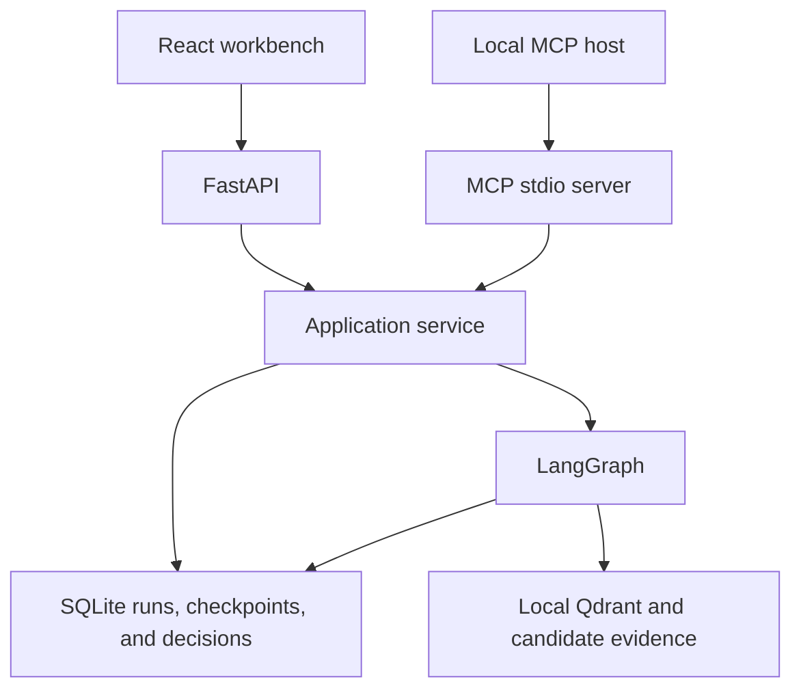
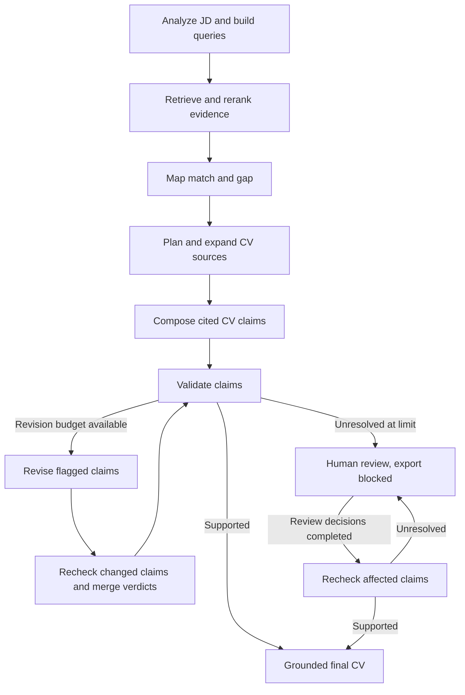

# Architecture

## Application workflow

Queries combine lexical BM25 and dense Qdrant candidates. A CrossEncoder
reranks the pool, and confidence-aware aggregation combines results across
queries. Weighted reciprocal rank fusion is also available for retrieval
benchmark comparisons. Requirements
are displayed with their recorded status and cited IDs. The workbench can
trace each claim back to its evidence and show how validation changed after
revision.

After an automatic revision, the Validator receives changed claim IDs.
Previously evaluated rows remain in the result when their claims are
untouched. Human-review decisions use a run-scoped overlay and retain an
auditable original status. Rejection removes citations, and a claim that
loses its last citation stays unsupported. Both adapters use the same CV
access rule, and the MCP adapter exposes review queries only.
